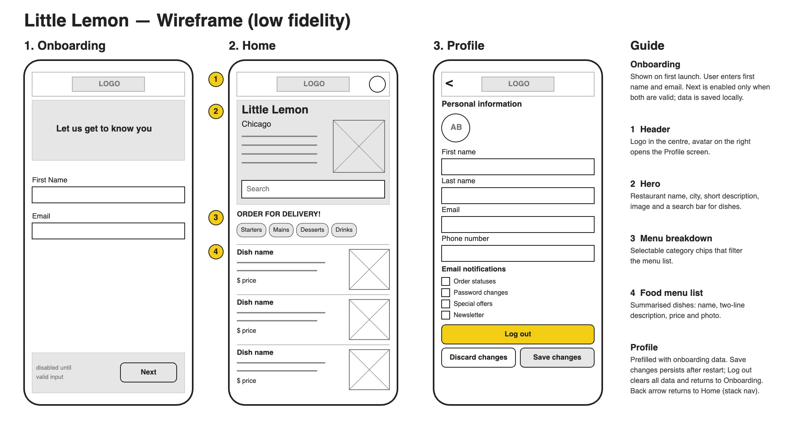

# Little Lemon — React Native Capstone

Food ordering app for the Little Lemon restaurant, built with **Expo** and **React Navigation** for the Meta React Native Capstone (Coursera).



## Features

- **Onboarding** (first launch): first name + email. The **Next** button is enabled only when both are valid.
- **Home**: header (logo + avatar → Profile), hero (restaurant description + search bar), menu breakdown (selectable categories), and the food menu list (name, short description, price, photo). The menu is downloaded once and cached locally.
- **Profile**: prefilled with the onboarding data; edit first/last name, email, phone and email notification preferences. **Save changes** keeps the data after the app restarts; **Discard changes** reverts edits; **Log out** clears all stored data and returns to Onboarding.
- **Stack navigation**: Home → Profile, with the Back button returning to Home.

## How to run

```bash
git clone https://github.com/aiabagdat/little-lemon-capstone.git
cd little-lemon-capstone
npm install
npx expo install --fix   # aligns package versions with your Expo SDK, if needed
npx expo start
```

Then scan the QR code with **Expo Go** (Android / iOS), or press `i` / `a` to open a simulator.

## How to review

1. First launch shows **Onboarding**. Type a first name and email — Next becomes active.
2. On **Home**, check the header, hero with search bar, category chips and the menu list. Try searching and selecting categories.
3. Tap the avatar (top right) to open **Profile** — your onboarding data is there. Use the Back button to return.
4. Change some fields, tap **Save changes**, restart the app — the changes remain.
5. Tap **Log out** — all data is cleared and Onboarding appears again.

## Wireframe

The wireframe the screens are based on is in [`wireframe.jpg`](./wireframe.jpg).

## Tech

Expo, React Native, React Navigation (native stack), AsyncStorage.
